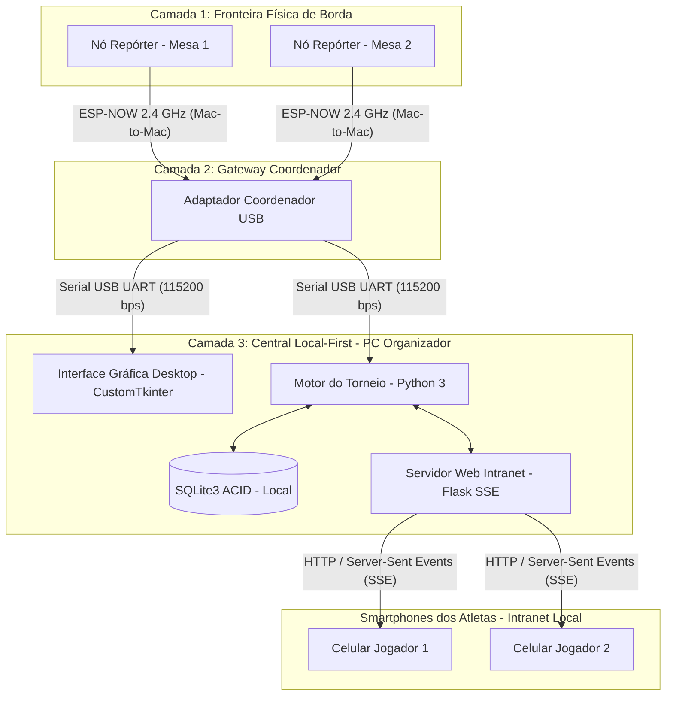

# Autoreporter 🏆
> **Sistema Ciberfísico Descentralizado para Automação Logística e Reporte de Torneios de Mesa**  
> Trabalho de Conclusão de Curso (TCC) — Engenharia de Computação — Pontifícia Universidade Católica do Paraná (PUCPR, 2026)  

## Informações Gerais

| Item | Informação |
| :--- | :--- |
| **Curso** | Engenharia de Computação |
| **Instituição** | PUCPR — Escola Politécnica |
| **Ano / Semestre** | 2026/2 |
| **Disciplina** | IOPT (Implementação e Operação de Projeto Transformador) — 4º Bimestre (Implementação Final) |
| **Estudante** | Dani Heart Basso |
| **Orientador** | Prof. Afonso Ferreira Miguel |
| **Área Técnica** | Sistemas Ciberfísicos / IoT / Redes Sem Fio / Engenharia de Software |

> **Nota Institucional:** Este diretório armazena **exclusivamente os códigos-fonte e scripts de teste** do projeto. O documento formal da monografia (*Projeto Final de Curso*) e os *Slides da Apresentação* encontram-se arquivados no **Canvas PUCPR**.

---

## 📌 1. Visão Geral do Projeto

O **Autoreporter** é um Sistema Ciberfísico (CPS) projetado para modernizar e automatizar a infraestrutura logística e o fluxo de reporte de resultados em torneios de mesa presenciais (como Trading Card Games, Xadrez, Tênis de Mesa e e-Sports em arenas).

### Problemas Solucionados:
1. **Eliminação do "Human Middleware":** Extingue a dependência de corredores (*runners*) e filas de atletas até a mesa central para entrega física de súmulas em papel.
2. **Resiliência a Ruído Eletromagnético (RF):** A telemetria crítica das mesas trafega sobre uma malha de rádio dedicada via protocolo **ESP-NOW a 2,4 GHz**, operando fora da infraestrutura Wi-Fi/IP convencional sujeita à saturação em salões lotados.
3. **Prova de Presença e Localidade (PoPL):** A validação do placar exige a autenticação presencial do crachá RFID passivo (13,56 MHz) na mesa física de jogo onde a partida foi designada, prevenindo fraudes e reportes acidentais à distância.
4. **Arquitetura *Local-First* Autônoma:** Todo o processamento de regras, banco de dados relacional (SQLite3) e servidor web local (Flask) residem no computador da organização, funcionando 100% *offline* sem conexão à internet.

---

## 🛠️ 2. Arquitetura do Sistema e Topologia em 3 Camadas



---

## 📂 3. Organização do Código

```text
autoreporter/
├── data/
│   ├── datasets/                      # Reservado para datasets de torneios futuros
│   └── exemplos/                      # Banco de dados SQLite local de testes (autoreporter.db)
├── src/
│   ├── backend/                       # Núcleo da lógica desportiva e serviços
│   │   ├── database/                  # DDL relacional (schema.sql) e CRUD (db_manager.py)
│   │   ├── gateway/                   # Driver serial multithread com rádio mock (serial_driver.py)
│   │   ├── motor/                     # Regras desportivas e chaveamento (tournament_engine.py)
│   │   ├── main.py                    # Orquestrador central e simulação headless
│   │   └── terminal_controle_hardware.py # Painel interativo de diagnóstico de bancada
│   ├── firmware/                      # Código C++ para microcontroladores ESP32 (PlatformIO)
│   │   ├── no_reporter/               # Firmware do Nó Repórter de Mesa (RFID + ESP-NOW)
│   │   └── adaptador_coordenador/     # Firmware do Adaptador Coordenador USB
│   └── frontend/                      # Interfaces de visualização e operação
│       ├── gui_app.py                 # Interface Gráfica Desktop do Organizador (CustomTkinter)
│       └── web/                       # Servidor Flask e Web App Mobile dos competidores (SSE)
│           ├── app.py                 # Rotas HTTP e streaming SSE
│           └── templates/             # Páginas HTML reativas (index.html, player.html)
├── tests/
│   ├── unitarios/                     # Testes unitários do ciclo nominal (test_module_1.py)
│   └── integracao/                    # Validação de integração e regras TW-01 a TW-05 (test_suite_v1.py)
├── requirements.txt                   # Manifesto de dependências Python
└── README.md                          # Instruções técnicas de instalação, compilação e execução
```

---

## 🔌 4. Pinagem Canônica e Hardware Homologado

Todos os dispositivos utilizam o SoC **ESP32 DevKit V1 (30 pinos)** acoplado a periféricos padronizados:

| Periférico | Função / Linha | GPIO (ESP32) | Pino Físico | Observações de Projeto |
| :--- | :--- | :---: | :---: | :--- |
| **RFID MFRC522** | SPI SDA (CS) | **GPIO 15** | Pino 18 | Barramento síncrono SPI |
| **RFID MFRC522** | SPI SCK | **GPIO 18** | Pino 24 | Clock SPI de alta velocidade |
| **RFID MFRC522** | SPI MOSI | **GPIO 23** | Pino 30 | Master Out Slave In |
| **RFID MFRC522** | SPI MISO | **GPIO 19** | Pino 25 | Master In Slave Out |
| **RFID MFRC522** | Reset (RST) | **GPIO 4** | Pino 20 | Linha de reinicialização do leitor |
| **RFID MFRC522** | Interrupção (IRQ)| **GPIO 22** | Pino 29 | Interrupção de hardware não bloqueante |
| **LED RGB 1 (Inferior)**| Vermelho (R) | **GPIO 25** | Pino 8 | Resistor limitador de $1\text{ k}\Omega$ em série |
| **LED RGB 1 (Inferior)**| Verde (G) | **GPIO 33** | Pino 7 | Resistor limitador de $1\text{ k}\Omega$ em série |
| **LED RGB 1 (Inferior)**| Azul (B) | **GPIO 32** | Pino 6 | Resistor limitador de $1\text{ k}\Omega$ em série |
| **LED RGB 2 (Superior)**| Vermelho (R) | **GPIO 14** | Pino 11 | Resistor limitador de $1\text{ k}\Omega$ em série |
| **LED RGB 2 (Superior)**| Verde (G) | **GPIO 27** | Pino 10 | Resistor limitador de $1\text{ k}\Omega$ em série |
| **LED RGB 2 (Superior)**| Azul (B) | **GPIO 26** | Pino 9 | Resistor limitador de $1\text{ k}\Omega$ em série |
| **Alimentação** | 3.3V / GND | — | Pinos 16 e 17 | Alimentação regulada pelo LDO do ESP32 |

---

## 🏭 5. Manufatura Física e Desenhos Técnicos

Os Nós Repórteres foram construídos em placas perfuradas de fibra de vidro de dupla face ($70 \times 90\text{ mm}$) e encapsulados em chassi protetor modelado no **Onshape** e impresso em termoplástico **PLA** na **Bambu Lab A1** (0,20 mm, 4 paredes, 15% Gyroid):

* **Desenho Técnico da Base (DWG Nº 1):** Envelope com $96,0 \times 80,0\text{ mm}$ (altura $25,5\text{ mm}$, R5), janela Micro-USB de $10 \times 6\text{ mm}$, 4 suportes internos de $\varnothing 2,2\text{ mm}$ para fixação da placa perfurada e 4 furos laterais de $\varnothing 2,9\text{ mm}$.
* **Desenho Técnico da Tampa (DWG Nº 2):** Envelope com $99,0 \times 83,0\text{ mm}$ (altura $17\text{ mm}$, R5), 2 orifícios zenitais de $\varnothing 6,0\text{ mm}$ (pitch $11,5\text{ mm}$) para LEDs RGB, marcador geométrico tátil/visual em baixo-relevo para aproximação de cartões RFID e 4 furos laterais de $\varnothing 2,9\text{ mm}$.
* **Fixadores Mecânicos:**
  * 4x Parafusos M2.5 $\times$ 6 mm (fixação mecânica da placa perfurada nos 4 suportes internos da base);
  * 4x Parafusos M3 $\times$ 8 mm (fixação mecânica lateral da tampa na base).

---

## 🚀 6. Instruções de Instalação e Execução

### Pré-requisitos:
* Python 3.11 instalado no sistema.
* VSCode com extensão PlatformIO (para gravação do firmware no ESP32).

### Passo a Passo (Ambiente Software):

1. **Instalar dependências de software:**
   ```bash
   pip install -r requirements.txt
   ```

2. **Executar a Interface Gráfica Principal do Organizador (Desktop CustomTkinter):**
   ```bash
   python src/frontend/gui_app.py
   ```

3. **Executar a Aplicação em Modo Simulação / Servidor Headless:**
   ```bash
   python src/backend/main.py
   ```

4. **Executar a Suíte Completa de Testes Automatizados (Caixa Branca e Caixa Preta):**
   ```bash
   python -m unittest discover tests
   ```

5. **Acessar as Aplicações Web (Rede Local / Intranet Wi-Fi):**
   * Painel Geral do Torneio: `http://localhost:5000`
   * Interface Mobile do Competidor 1: `http://localhost:5000/player/1`
   * Interface Mobile do Competidor 2: `http://localhost:5000/player/2`

---

## 📄 7. Licença e Autoria
Projeto acadêmico desenvolvido no âmbito do Trabalho de Conclusão de Curso em Engenharia de Computação da Pontifícia Universidade Católica do Paraná (PUCPR, 2026). Todos os direitos reservados aos autores e à instituição.
